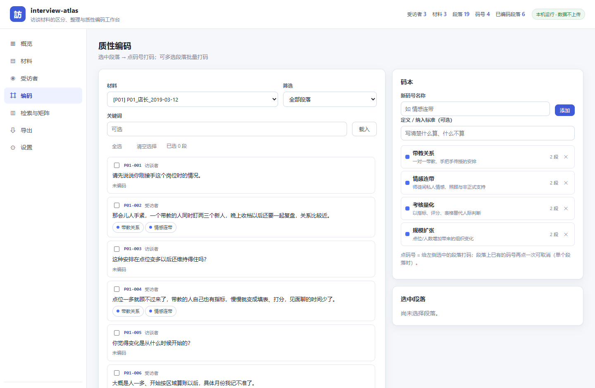
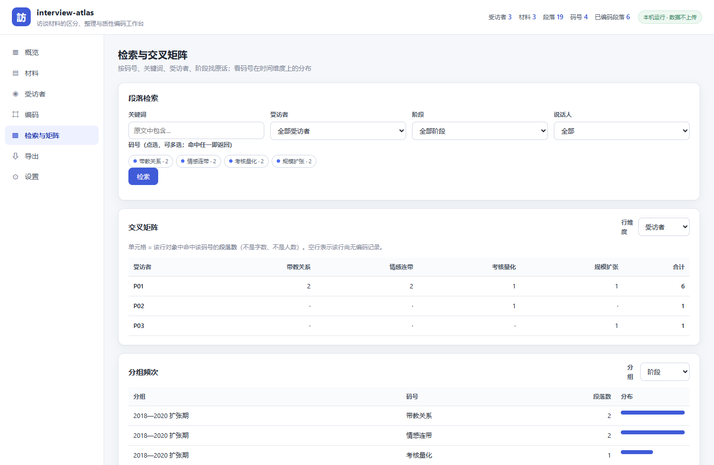

# interview-atlas｜访谈材料整理与编码工作台

[](https://github.com/yijiazong/interview-atlas/actions/workflows/ci.yml)


一个面向质性研究的本地 Web 工具（Python + Flask + 原生 JavaScript），把散乱的访谈逐字稿变成可核查、可编码、可导出的材料库：  
按受访者区分 → 脱敏编号 → 切成带编号的段落 → 建码本打码 → 检索与交叉矩阵 → 导出清单和引语汇编。

设计上刻意守住三条：**数据不出本机**、**原文不改写**、**每条引语都能回溯到出处**。  
工具只负责整理与记录，不替你做分析、不自动生成结论，也不自动编码。

## 界面预览

质性编码（选中段落 → 批量打码）与「受访者 × 码号」交叉矩阵（纵向上看码号分布随研究阶段的变化）：

<p>
  
  
</p>

> `examples/` 里的三份"访谈稿"与截图中使用的数据均为**虚构演示数据**，不是真实访谈记录，不得用于论文引用。

---

## 一、快速开始（3 步）

```bash
cd interview-atlas
python -m pip install -r requirements.txt
python app.py
```

启动后终端会显示：

```
打开：http://127.0.0.1:5000/
数据：<项目目录>/data
```

默认会自动打开系统浏览器；没弹出就手动复制上面那行链接到浏览器。**这个链接就是日常入口**。

- 停止服务：在终端按 `Ctrl + C`
- 换端口：`ATLAS_PORT=5001 python app.py`（Windows CMD 用 `set ATLAS_PORT=5001` 再运行）
- 不自动弹浏览器：`ATLAS_NO_BROWSER=1 python app.py`

依赖说明：`Flask` 是必需项；`python-docx`（读 .docx）、`pypdf`（读 .pdf）、`openpyxl`（导出 .xlsx）是格式增强项。  
如果只处理 `.txt / .md / .csv / .srt / .vtt / .json`，只装 Flask 也能跑，缺哪个包只影响对应格式，并会给出明确提示。

---

## 二、标准工作流

### 1. 导入材料（「材料」页）

拖拽或选择多份逐字稿，也可以填一个文件夹绝对路径做批量导入（只扫描一层，不递归）。  
系统会自动：

- 识别说话人标签，切成段落；
- 给每段一个唯一编号，如 `P01-003`（写论文时就用它做引用定位）；
- 从文件名推断受访者编号、访谈日期、轮次、身份；
- 把原件复制一份到 `data/sources/`，便于备份和回溯。

导入后**一定先点「查看段落」人工核对一遍**：自动切分和说话人识别是启发式的，  
PDF 尤其可能出现断行或错字。段落支持双击直接改字、改说话人、删除。

### 2. 区分与脱敏（「受访者」页）

- 确认每份材料归到哪位受访者；改归属后段落编号会自动重编，不会串号。
- 给受访者补化名、身份、单位、访谈日期、阶段、轮次。
- **脱敏映射**：手动登记「原文写法 → 替换文本」，点「应用到全部原文」批量替换。  
  替换会改写已入库文本且**不可撤销**，操作前建议先在「导出」页做一次整包备份。

> 系统不会自动猜姓名。中文姓名边界模糊，自动替换容易误伤正文，宁可让你确认一次。

### 3. 编码（「编码」页）

- 先建码本：码号名称 + 定义（建议写清「什么算、什么不算」）。
- 选中一个或多个段落 → 点右侧码号即可批量打码；再点一次可取消。
- 支持「仅未编码」筛选和关键词过滤，适合先做开放编码再逐轮收敛。

### 4. 检索与矩阵（「检索与矩阵」页）

- 按关键词、码号、受访者、阶段、说话人筛段落，结果带完整出处。
- **交叉矩阵**：行可选受访者 / 阶段 / 访谈轮次 / 年份 / 说话人，列是码号，  
  单元格是**段落数**。做纵向单案例时，用「阶段」或「年份」看码号分布的变化最方便。
- 分组频次表给出同样的数字，只是长表形式，便于导出。

### 5. 导出（「导出」页）

| 导出物  | 用途                                   |
| ---- | ------------------------------------ |
| 材料清单 | 一份访谈一行：编号、化名、身份、日期、阶段、段落数、编码进度       |
| 全部段落 | 段落编号 + 说话人 + 原文 + 已打码号，可拿去和原始转录稿逐条核对 |
| 编码明细 | 每段 × 每码一行，含码号定义与编码备注                 |
| 交叉矩阵 | 当前行维度的计数表                            |
| 引语汇编 | 按码号分组，**原文照录** + 完整出处，写论文找引文时用       |
| 整包备份 | `data/atlas.db` + 原始逐字稿副本，ZIP        |

CSV 一律 UTF-8 BOM，Windows 双击直接用 Excel 打开不乱码。  
引语汇编里的每条原话都附「受访者编号 / 材料 / 段落号 / 访谈日期 / 阶段」，  
但**正式引用前请对照原始录音或转录稿再核一次**；本工具不生成 GB/T 7714 格式的文献条目，  
也不替你判断引语的代表性。

---

## 三、文件命名约定（决定自动推断准不准）

推荐格式：

```
P01_店长_2019-03-12.docx
P02_服务员_2021-07-08_第2轮.md
P03_主管_2022-05-01.srt
```

| 片段                     | 识别为     | 规则                                         |
| ---------------------- | ------- | ------------------------------------------ |
| `P01`                  | 受访者编号   | `P` + 数字；同一人多轮沿用同一编号                       |
| `2019-03-12`           | 访谈日期    | `YYYY-MM-DD`（也支持 `YYYY.MM.DD`、`YYYY年M月D日`） |
| `第2轮` / `T2` / `wave2` | 访谈轮次    | 缺省为第 1 轮                                   |
| 其余中文词                  | 身份 / 化名 | 取第一个非数字词作身份                                |

推断结果全部可以在界面里改。文件名不含编号时，材料会先记为「未归类」，之后再用「归属」按钮指定。

### 支持的格式

`.docx` `.pdf` `.txt` `.md` `.markdown` `.csv` `.xlsx` `.srt` `.vtt` `.json`

说话人标签支持这些写法（行首 + 冒号）：

```
问：……          访谈者：……        Q: ……
答：……          受访者：……        P01: ……
```

`.srt/.vtt/.json` 会保留时间戳。`.json` 支持数组或含 `segments`/`utterances` 的对象，  
字段可为 `text/content/文本/内容` 与 `speaker/role/说话人`。

---

## 四、录音还没转写怎么办（可选模块与能力边界）

这个模块是**可选的**，分两条路：

**路线 A（推荐，最省事）**：用支持说话人分离的外部转写工具把录音转成 `.srt / .vtt / .json`，  
直接在「材料」页导入，说话人标签和时间戳都会保留；也可使用任意转写服务先出初稿再按上述格式导入。

**路线 B（本地离线转写）**：

```bash
pip install -r requirements-transcribe.txt
```

然后在「设置」页选模型、上传音视频。首次运行会联网下载一次模型  
（`small` 约 460MB，`medium` 约 1.5GB），之后完全离线。

**必须说清的限制**：

- faster-whisper 只做「语音 → 带时间戳的文字」，**不自动区分说话人**。  
  自动说话人分离需要另接 pyannote 模型并申请 HuggingFace token，本工具没有、也不假装具备。  
  转写后请在「材料」页按文档批量标注说话人，并人工核对错字。
- 未安装依赖时，界面会明确提示安装命令并提供路线 A，不会静默失败。
- 模型缓存不进仓库（已 gitignore）。

---

## 五、数据与隐私

- 服务只监听 `127.0.0.1`，**不要改成 `0.0.0.0`，也不要部署到公网**。
- 全部数据落在项目内的 `data/`（SQLite 数据库 + 原件副本），导出物落在 `export/`。
- `data/` 与 `export/` 已写进 `.gitignore`，推送前请再跑一次 `git status` 确认没有原始材料被暂存。
- 想清空项目：停掉服务，删掉 `data/atlas.db` 即可（原件副本仍在 `data/sources/`，需要的话一并删）。
- 想备份 / 换电脑：在「导出」页生成整包 ZIP，解压到新机器的项目根目录覆盖 `data/` 后重启。

---

## 六、GitHub 仓库与代码同步

代码托管在 GitHub：

- 仓库地址：https://github.com/yijiazong/interview-atlas
- 克隆：`git clone https://github.com/yijiazong/interview-atlas.git`
- 默认分支：`main`；GitHub Actions 在 push / PR 时自动于 Python 3.10–3.13 跑单元测试（徽章见文首）。

日常改动后（网络允许 git 传输时）：

```bash
git status                       # 确认 data/、export/ 没有被暂存
git add . && git commit -m "说明"
git push
```

**网络受限环境下的替代通道**：某些代理只放行 `api.github.com`、封禁 `github.com` 的
git 智能传输端点，`git push` 会报 `schannel ... missing close_notify` 或
`CONNECT tunnel failed 502`。此时用仓库自带的 REST API 同步工具（走 GitHub 官方 API，
等效于 push，重建出的提交 SHA 与本地完全一致）：

```bash
python tools/sync_to_github.py            # 增量同步本地领先的提交
python tools/sync_to_github.py --force   # 全量重建历史（改写提交后使用）
```

前提：已安装 GitHub CLI 并完成 `gh auth login`（token 需 `repo`、`workflow` 权限）；
工具从 `origin` 解析仓库地址，找出本地领先的提交，增量重建 blob / tree / commit 后更新
`refs/heads/main`。它只同步**已提交**内容，并在本地与远端历史分叉时拒绝执行，避免覆盖。
网络正常时直接用 `git push` 即可，不必用它。

> 访谈原文永远只在本机：`data/`、`export/` 已写进 `.gitignore`，不会进入仓库。

---

## 七、跑测试

```bash
python -m unittest discover -s tests -v
```

覆盖：说话人切分、SRT/JSON 解析、文件名推断、段落编号与重编、编码/检索/矩阵、  
脱敏、各类导出、转写依赖缺失时的降级提示。测试全程用临时目录，不碰真实数据。

---

## 八、目录结构

```
interview-atlas/
├── app.py                     Flask 入口与 REST API（只监听 127.0.0.1）
├── atlas/
│   ├── config.py              路径与常量
│   ├── db.py                  SQLite 表结构与 CRUD
│   ├── importers.py           各格式解析、说话人识别、段落切分与编号
│   ├── anonymize.py           脱敏映射与应用
│   ├── coding.py              码本、打码、检索、矩阵、频次、清单、引语
│   ├── exporters.py           CSV / XLSX / Markdown / ZIP
│   └── transcribe.py          可选 faster-whisper 转写
├── web/                       原生 HTML / CSS / JS 单页界面
├── docs/screenshots/          README 界面截图（虚构演示数据）
├── tests/                     unittest 回归测试
├── .github/workflows/ci.yml    GitHub Actions 多版本 Python 测试
├── tools/
│   └── sync_to_github.py      git push 被代理阻断时的 REST API 增量同步
├── examples/                  ⚠️ 虚构演示数据（不可引用）
├── data/                      运行时数据（gitignore）
└── export/                    导出物（gitignore）
```

---

## 九、已知限制（不粉饰）

- PDF 文本提取质量取决于文件本身；**扫描版 PDF 没有 OCR**，需先转成可复制文字的文档。
- 说话人标签识别基于常见写法，特殊排版需要人工校对；转写稿不自动区分说话人。
- 文件名推断是启发式的，身份/阶段等字段请人工确认。
- 不做自动编码、主题建模、情感分析或 AI 归纳；统计只到「段落数」这一层，不做显著性检验。
- 面向单用户本机使用：没有账号体系、没有并发写锁、没有协同编辑。
- 不改写、不摘要、不润色原文；引语汇编只是把原文照录并按码号重排。

---

## 十、许可

MIT。见 `LICENSE`。
